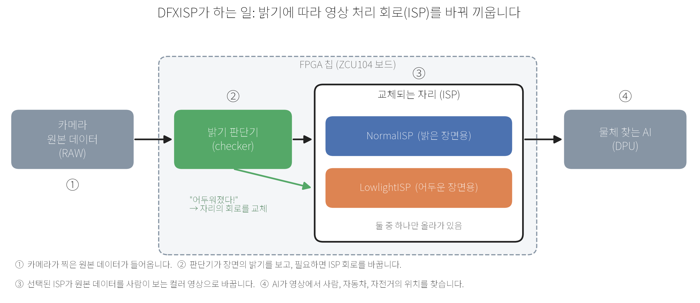
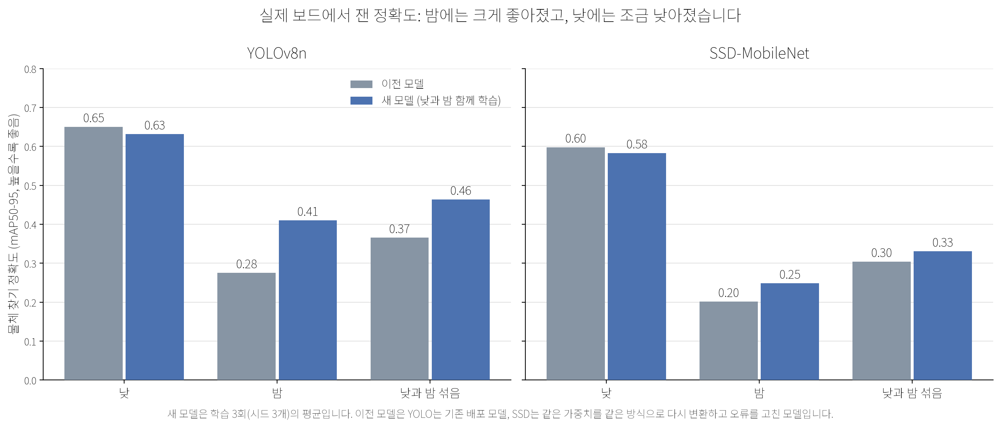

# DFXISP: 어두운 곳에서도 물체를 잘 찾는 카메라 영상 처리

카메라가 어두운 장면을 찍으면 컴퓨터가 사람, 자동차, 자전거를 잘 못 찾습니다. 이 프로젝트는 **장면이 밝은지 어두운지에 따라 영상 처리 회로를 실시간으로 바꿔 끼우는 방법**을 만들고, 실제 FPGA 보드에서 잘 되는지 측정합니다.

## 한눈에 보기



1. 카메라는 사람이 보는 사진이 아니라 **원본 데이터(RAW)** 를 냅니다.
2. **밝기 판단기(checker)** 가 장면이 밝은지 어두운지 봅니다.
3. **ISP**(영상 처리 회로)가 원본 데이터를 컬러 영상으로 바꿉니다. 밝은 장면에는 `NormalISP`, 어두운 장면에는 `LowlightISP`를 씁니다. 칩 안에는 둘 중 하나만 올라가 있고, 장면이 바뀌면 그 자리만 **부분 재구성**(DFX)으로 교체합니다.
4. **물체 찾는 AI**(검출 모델)가 영상에서 사람, 자동차, 자전거의 위치를 찾습니다.

## 왜 이렇게 하나요?

- 어두운 장면에 잘 맞는 처리와 밝은 장면에 잘 맞는 처리는 서로 다릅니다. 하나로 둘 다 잘하기는 어렵습니다.
- 두 회로를 칩에 **항상 함께** 올려 두면 자리와 전력이 더 듭니다. 필요한 쪽만 바꿔 올리면 자원을 아낄 수 있습니다.

## 결과 한 장 요약



실제 ZCU104 보드에서 잰 값입니다. 숫자가 높을수록 물체를 더 정확히 찾습니다.

- **밤:** 크게 좋아졌습니다. YOLOv8n은 0.28에서 0.41로, SSD-MobileNet은 0.20에서 0.25로 올랐습니다.
- **낮과 밤 섞음:** 두 모델 모두 좋아졌습니다.
- **낮:** 두 모델 모두 조금 낮아졌습니다. 낮 성능이 떨어지지 않는다고는 아직 말할 수 없습니다.
- 좋아진 이유의 대부분은 **낮과 밤 사진을 함께 학습한 AI 모델**입니다. 회로를 바꿔 끼우는 방식 자체가 정확도를 높였다는 증거는 얻지 못했습니다.

### 이 결과를 읽을 때 알아둘 점

- **새 장면 검증은 아직 못 했습니다.** 이전에 쓴 시험 사진을 다시 사용했기 때문에, 처음 보는 장면에서도 같을지는 모릅니다.
- **학습을 3번 반복한 평균입니다.** 같은 방법으로 반복한 것이라 완전히 독립된 확인은 아닙니다.
- **회로 교체 방식(DFX)이 가장 좋은 고정 회로보다 정확하다는 근거는 없습니다.** 어두운 곳에서 어두운 장면용 회로를 고정해 둔 것과 같은 수준이었습니다. DFX의 장점은 정확도가 아니라 **자원 절감**에 있습니다.
- 사진을 한 장씩 차례로 처리했습니다. 영상이 실시간으로 들어올 때 프레임을 놓치는지는 측정하지 않았습니다.

## 용어 풀이

| 용어 | 쉬운 설명 |
|---|---|
| **ISP** | 카메라 원본 데이터를 사람이 보는 컬러 영상으로 바꾸는 처리 회로 |
| **RAW** | 카메라 센서가 낸 가공 전 데이터 |
| **FPGA** | 회로를 다시 짤 수 있는 칩. 이 프로젝트는 AMD의 ZCU104 보드를 씁니다 |
| **DFX (부분 재구성)** | 칩이 켜진 채로 일부 회로만 다른 회로로 바꿔 끼우는 기술 |
| **DPU** | 보드 위에서 AI 모델을 돌리는 전용 회로 |
| **mAP50-95** | 물체를 얼마나 정확히 찾는지 나타내는 점수(0에서 1, 높을수록 좋음) |
| **YOLOv8n, SSD-MobileNet** | 이 프로젝트에서 쓴 두 가지 물체 찾기 AI 모델 |

## 어디부터 읽을까요?

| 이런 분은 | 여기를 보세요 |
|---|---|
| 결과가 궁금한 분 | [`docs/experiments/2026-10-v2-board/README.md`](docs/experiments/2026-10-v2-board/README.md) |
| 숫자 표를 보고 싶은 분 | [`docs/experiments/2026-10-v2-board/results/final_live_comparison/comparison.md`](docs/experiments/2026-10-v2-board/results/final_live_comparison/comparison.md) |
| 연구 목표와 설계가 궁금한 분 | [`SPEC.md`](SPEC.md) 와 [`ROADMAP.md`](ROADMAP.md), 연구 계획서 [`research_plan/DFXISP_연구계획서.pdf`](research_plan/DFXISP_연구계획서.pdf) |
| 진행 상황이 궁금한 분 | [`ROADMAP.md`](ROADMAP.md) |
| 회로 코드를 보고 싶은 분 | `isppipeline/hls/` (회로 설계 소스), `hw/` (보드 구현) |

## 폴더 구조

```text
docs/experiments/   실험 결과 정리 (이번 보드 실험은 2026-10-v2-board)
docs/assets/        이 README의 그림
isppipeline/        ISP 설계 (소프트웨어 기준값, 회로 설계 소스)
hw/                 FPGA 보드 구현 (NormalISP, LowlightISP, checker, 보드 시험)
model/              AI 모델 정보 (모델 파일 자체는 별도 보관)
archive/            이전 문서 보관
```

## 직접 확인해 보기

```text
cd isppipeline/hls
make verify        # 소프트웨어 기준값과 회로 시뮬레이션이 정확히 일치하는지 확인
make report        # 검증 결과를 reports/latest.md 에 정리
```

보드 실험을 다시 하려면 FPGA 보드(ZCU104)와 AMD 도구(Vivado, Vitis 2024.1)가 필요합니다.

## 참고 링크

- 코드 저장소: <https://github.com/haengmini/dfxisp>

---

# 연구자용 상세 문서

아래는 연구자를 위한 기존 개요입니다. 처음 보시는 분은 위 내용만 읽으셔도 됩니다.


<details>
<summary>프로젝트 메타데이터 (기존 문서 머리말)</summary>

```yaml
type: project
title: DFXISP
layer: production
status: active
priority: P0
board: dfxisp
created: 2026-06-23
owner: 이형민
tags: [fpga, dfx, isp, machine-vision, zynq-ultrascale, low-light]
updated: 2026-08-04
```

</details>

## DFXISP (연구자용 개요)

DFXISP는 Zynq UltraScale+ ZCU104에서 **static shell(ISP 연산이 없는 AXI/체커/DFX 컨트롤러)** 위에 조도 조건에 따라 상호배타로 스왑되는 **mode-specific 전체 ISP pipeline RM**(`RM_NORMAL`/`RM_LOW_LIGHT`, 각각 demosaic→BLC→WB/AWB→CCM→gain→gamma를 통째로 소유)을 얹는 Dynamic Function eXchange 기반 AI-ISP 연구 프로젝트다. baseline core는 두 RM 사이에 하드웨어로 공유되지 않는다(소스 함수 `apply_blc_wb12()`만 공유 — 실리콘에는 RM마다 중복 구현, `SPEC.md` §7 "RP 경계"). 평상시에는 `RM_NORMAL`, 어두운 환경에서는 `RM_LOW_LIGHT`를 (체커가 판단해) 트리거한다.

## 연구 목표 (정본: RESEARCH.md §1)

컴퓨터 비전(CV) 검출기는 조도에 따라 다른 전처리를 요구한다. 하나의 static ISP로 밝은·어두운 장면을 모두 처리하면 저조도에서 CV 성능·효율이 떨어진다. 따라서:

- **목표 1 — 필요성:** 저조도에 특화된 ISP 모듈이 CV에 더 적합하다. 단일 모듈은 각각 **자기 조건의 데이터셋에서 상대 모듈보다 높은 성능**을 낸다(normal→밝은 조도, low-light→저조도). 한 모듈로 두 조건을 다 이기지 못하므로 전환이 필요하다.
- **목표 2 — 전환:** 상황에 맞춰 모듈을 전환(adaptive)하고, 이를 **DFX 부분재구성**으로 구현해 always-on 대비 **자원·전력 효율**까지 얻는다.

**증명 순서: SW(golden/mAP)로 필요성·전환을 먼저 확립 → HW(HLS→DFX→보드)로 이식**, HW/보드의 고유 기여는 효율이다. CV 성능 비교 arm은 `**normal`/`lowlight`/`adaptive`** 세 가지이며, 색보정을 거치지 않는 `none`(무처리)은 배포 가능한 ISP 출력이 아니므로 **비교에서 제외**한다.

## Active architecture

```text
Input real-RAW Bayer (PASCAL RAW 밝음 / LOD RAW 저조도; 초기엔 pseudo-RAW proxy)
  -> Scene checker (static shell, ISP 연산 없음)
       - 평상시: RM_NORMAL 트리거
       - 어두운 환경: RM_LOW_LIGHT 트리거
  -> Mutually exclusive 전체 ISP pipeline RM (RP가 통째로 스왑)
       RM_NORMAL:     demosaic -> BLC -> AWB/CCM -> gain 1.25x -> gamma
       RM_LOW_LIGHT:  2x2 binning-demosaic -> BLC(완화) -> AWB/CCM -> gain 2.0x -> gamma
  -> RGB32 pack / DPU-facing output
```

핵심 원칙:

1. **Static shell에는 ISP 데이터패스가 없다.** static은 AXI/제어, checker/mode-FSM, DFX/PR 컨트롤러, output/metadata packer뿐이다. baseline core(BLC/AWB/demosaic/CCM)를 static·공유 하드웨어로 두지 않기로 결정했다(2026-07-10 reset v2, 이유는 `RESEARCH.md` §0) — 두 RM이 그 값보다 훨씬 작으면 always-on(Arm2)과 자원 차이가 거의 없어 DFX 채택 근거 자체가 약해지기 때문.
2. **각 RM(`RM_NORMAL`/`RM_LOW_LIGHT`)이 자기 파이프라인 전체(demosaic→BLC→AWB/CCM→gain→gamma)를 통째로 소유한다.** 두 RM이 호출하는 `apply_blc_wb12()`는 **소스 레벨에서만** 같은 함수 정의고(BLC/WB 산술의 bit-exact 일치 보장 목적), 합성 시 RM마다 독립적으로 중복 구현된다 — 실리콘에 공유 인스턴스는 없다(`SPEC.md` §7 "RP 경계", §11.12).
3. **RM_NORMAL과 RM_LOW_LIGHT는 mutually exclusive다** — 프레임/세그먼트당 정확히 하나만 상주·활성.
4. **Checker가 어두운 장면을 감지했을 때만 RM_LOW_LIGHT를 트리거한다.**
5. **RM_LOW_LIGHT의 저조도 특화 요소는 `2x2 binning-demosaic + 완화 BLC + gain 2.0x`다.** 이득 귀속(기대 vs 실측)은 `results/lowlight-module-techniques-2026-07-10.md` — 주효인은 완화 BLC, binning은 real-RAW에서 조건부, 별도 톤 LUT는 기각.
6. DFX 실증 전에는 C-Sim/Python golden으로 산술 정합을 먼저 고정한다.

## Current status (2026-08-04)

- **SW 트랙 (Stage 0~3): 절차 완료, real-RAW 기준으로 동결** — golden/baseline core, checker(+principled-v3 SOTA 후속), tone RM 산술+이득귀속, mAP 평가. **Stage 3 "정확도 재검증 허브"**가 2026-07-20에 한 바퀴 완주했다 — 정본 데이터셋(LOD=SonyNOD/PASCAL=PASCALRAW real-RAW, Shuffle_split 642장) 교차검증 완료, 그 실측 근거로 **BLC 재보정(16/8→2/2) 배포**. 정성적 결론(저조도 모듈이 dark 조건에서 normal 상회)은 견고하게 재확인됨.
- **Checker: SOTA 강화 4개 관문 전부 완료(2026-07-20)** — C0(dark50&gt;0.80)→**C1(dark16&gt;0.62) 정식 배포**, 오라클 라벨 재정의로 잔존오차의 89.6%가 라벨 아티팩트임을 확인해 **C1 재조정 불필요**로 결론. 상세: `isppipeline/hls/results/checker-status-2026-07-10.md` §4.
- **HW 트랙 (Stage 4~5): 완료(한계 기록됨)** — Vitis HLS 합성 + C/RTL Co-sim, Vivado DFX 구현 + pr_verify + PR latency 분석. BLC/checker 상수 반영 **csynth/cosim 재실행 완료**(07-20, 자원·타이밍 완전 동일)와 **Vivado DFX fabric-only 재구현 완료**(08-01, pr_verify PASS·partition pin 3·bitstream 크기 일치).
- **3-arm 자원 비교 완성(2026-08-04)** — 비어 있던 Arm1 칸을 메우고 세 arm을 **post-route 축으로 통일**했다. 적응성의 비용은 Arm1 3,363 → Arm2 4,768 LUT(+41.8%)이고, **DFX는 Arm2 대비 normal 모드 −29.5%, low-light 모드 −50.8% LUT를 절감**한다(모두 동일 래퍼·플로우로 배치·배선한 실측). 상세: `SPEC.md` §10.1~§10.3.
- **색보정 상수의 모드별 분리: 두 건 모두 기각(2026-08-04 확정)** — BLC는 모드별 배포 후 real-RAW 재보정에서 양쪽 2로 수렴(07-20), WB는 real-RAW 분리 재튜닝에서 mAP 무반응으로 기각(08-03). 두 모드의 실질적 차이는 **색보정 상수가 아니라 구조**(binning, 노출 게인)에 있다. 상세: `isppipeline/hls/results/lowlight-wb-mode-split-2026-08-03.md`.
- **Stage 6 (보드 실장 + DPU end-to-end): 미착수** — 실물 ZCU104 필요, **보드 없이 할 수 있는 절차 중 유일하게 남은 것**. 목표 2의 효율(전력) 실증이 여기 걸림.
- 실제 진행은 선형이 아니라 **나선형**(Stage 5까지 올라갔다 SW Stage 3으로 되돌아오는 되먹임 반복) — 상세는 `ROADMAP.md`.

## Next direction

**즉시:** (1) YOLOv8s 교차 모델 검증 결과 회수·정리(노트북 RTX 5060에 인수인계, 진행 중), (2) SSDLite 교차검증(글루 코드 필요). 둘 다 이미 배포된 결정을 막지 않으며 논문 일반화 주장 보강용이다. 그 다음은 **Stage 6(보드) 착수** — checker→PR 트리거 체인은 fabric RTL로 구현·시뮬 검증됐고(2026-08-06, `checker_hysteresis.v` + xsim end-to-end PASS), 남은 선결 과제는 실배선(`hyst_flags` 포트, `drain_ready`↔RM `ap_idle`)과 ICAPE3/STARTUPE3 인스턴스화다 — 이것이 유일한 진짜 blocking item이다.

**보류 중인 리팩토링 방향:** `STRATEGY.md`가 제안한 **Vitis Vision Library 기준 baseline + DFXISP 확장 모듈** 구조(Vitis Base를 고정하고 Check/Dark/DFX Ctrl을 확장)는 2026-07-03에 제안됐으나 **아직 착수되지 않았다** — checker/BLC real-RAW 재보정 트랙이 우선됐다. 착수 여부·시점은 미결정.

## Active documents

- `README.md` — 프로젝트 한 페이지 요약 (이 문서)
- [`archive/dfxisp-v2-renewal-2026-08-07/RESEARCH.md`](archive/dfxisp-v2-renewal-2026-08-07/RESEARCH.md) — (보관됨) 연구 정본: 배경, 아키텍처, RM 명세, 실험/검증 계획
- `SPEC.md` — 시스템 사양서: 입력 데이터셋 → checker → mode-specific 전체 ISP pipeline RM → RGB32 출력 → 평가
- `ROADMAP.md` — Stage 0~6 진행 상태 추적 (근거 문서 링크 포함)
- [`archive/dfxisp-v2-renewal-2026-08-07/STRATEGY.md`](archive/dfxisp-v2-renewal-2026-08-07/STRATEGY.md) — (보관됨) Vitis-first 리팩토링 전략 (2026-07-03, 다음 구현 방향)

실험/시뮬레이션 산출물 전체 목록은 `isppipeline/hls/results/INDEX.md` 에서 찾을 수 있다.

이전 문서들은 `archive/docs-reorg-2026-07-01/` 에 보존되어 있다 (`archive/README.md` 참조).

## Repository layout

```text
README.md / RESEARCH.md / SPEC.md / ROADMAP.md / STRATEGY.md   정본 문서 5종
isppipeline/hls/            HLS 구현 (src, include, tests, tools, scripts)
isppipeline/hls/results/    실험·시뮬레이션 산출물 (INDEX.md 로 탐색)
isppipeline/hls/reports/    최신 검증 리포트 (latest.md) + csynth 리포트
isppipeline/baseline/       Baseline ISP 참고 자료
isppipeline/proposal/       Proposal ISP 참고 자료 (historical)
model/                      Detector 모델 메타데이터 (weights는 Drive 백업)
include/aie-ml/             AIE-ML 참고 자료
archive/                    이전 구조의 문서 보존 (archive/README.md 참조)
hw/                         HW 구현 단계(laptop-linux, Vivado/HLS 프로젝트 + ZCU104 보드 검증).
                            isppipeline/의 SW 설계를 이어받아 실제 보드에 구현·검증하는 후속 단계.
                            LowlightISP/NormalISP(+_DPU 변형)/checker/board_test/docs/tools 구조.
                            빌드 산출물(PetaLinux/Yocto, Vivado .runs/.gen/.sim, HLS csim/sim/impl)은
                            hw/.gitignore로 제외 -- 소스.프로젝트 파일.설계 문서만 추적.
```

## Verification status

```text
cd isppipeline/hls
make verify        # Python golden ↔ C-sim bit-exact + binning cross-check
make report        # reports/latest.md 갱신
```

`reports/latest.md` 기준: golden PASS, C-sim PASS, 아키텍처 gate 6종 PASS — 그중 "shared baseline core"는 **하드웨어 공유가 아니라 두 RM의 BLC/WB 소스 함수가 bit-exact로 일치하는지 보는 산술 회귀 게이트**다(실제 RP 경계는 `SPEC.md` §7 참고). 나머지: RM 2종 존재 / 상호배타 선택 / gain·gamma 중복없음 / 형상정책.

## Related locations

- GitHub (code source of truth): [https://github.com/haengmini/dfxisp](https://github.com/haengmini/dfxisp)
- Google Drive 백업: `내 드라이브/Agent OS/06-production/DFXISP/` (dataset zip, 모델 weights, 다이어그램, lit-reviews 포함)

