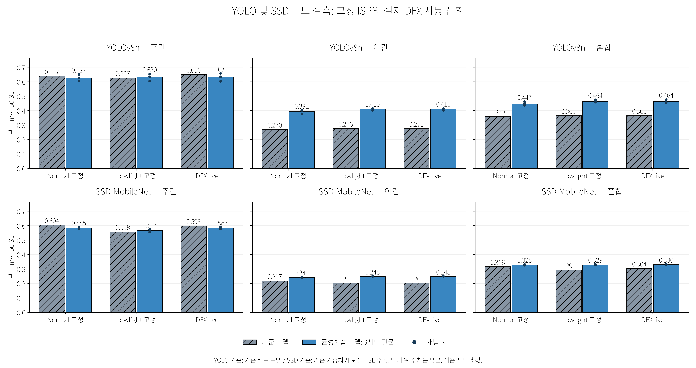
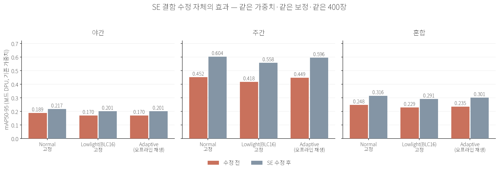

# 2026-10 보드 실험 결과: 어두운 장면에서 물체를 더 잘 찾게 만들기

이 폴더는 FPGA 보드(ZCU104)에서 직접 잰 실험 결과를 모아 둔 곳입니다. 전체 프로젝트 소개는 [첫 화면 README](../../../README.md)를 먼저 보세요.

## 3줄 요약

1. **밤에 크게 좋아졌습니다.** 낮과 밤 사진을 **함께** 학습시킨 새 AI 모델로 바꾸니 밤 정확도가 YOLOv8n은 0.28에서 0.41, SSD-MobileNet은 0.20에서 0.25로 올랐습니다.
2. **낮은 조금 낮아졌습니다.** 낮에도 문제없다고 말할 수 있는 근거는 아직 없습니다.
3. **회로를 바꿔 끼우는 방식(DFX)이 정확도를 더 올린다는 근거는 없습니다.** 어두운 곳에서 어두운 장면용 회로를 고정해 둔 것과 같은 수준이었고, DFX의 장점은 자원 절감입니다.

## 이 실험은 무엇을 확인했나요?

| 질문 | 답 |
|---|---|
| 어두운 장면용 회로(LowlightISP)와 새 AI 모델을 쓰면 밤에 더 잘 찾나요? | **네.** 두 모델 모두 좋아졌습니다. |
| 그 개선이 회로 덕분인가요, AI 모델 덕분인가요? | **대부분 AI 모델과 학습 데이터 덕분**입니다. 회로 선택만의 효과는 확인하지 못했습니다. |
| 밝기에 따라 회로를 자동으로 바꿔도 잘 동작하나요? | **네.** 보드에서 600장을 실제로 돌려 끝까지 동작했습니다. 정확도는 가장 좋은 고정 회로보다 높지 않았습니다. |
| 낮 성능은 유지되나요? | **아직 모릅니다.** 조금 낮아졌습니다. |
| 처음 보는 장면에서도 같을까요? | **아직 모릅니다.** 이전에 쓴 사진으로 다시 잰 값입니다. |

## 결과 그림

### 1. 실제 보드에서 잰 정확도

숫자는 물체를 얼마나 정확히 찾는지 나타내며 높을수록 좋습니다. 회색은 이전 모델, 파랑은 새 모델입니다. 밤(가운데)에서 새 모델이 확실히 높습니다.

### 2. 고정 회로 두 가지와 자동 교체를 나란히 비교

- **Normal 고정:** 밝은 장면용 회로만 계속 씁니다.
- **Lowlight 고정:** 어두운 장면용 회로만 계속 씁니다.
- **DFX live:** 판단기가 장면마다 골라서 실제로 회로를 바꿔 끼웁니다.
- 줄무늬 막대는 이전 모델, 색 막대는 새 모델입니다.

세 방식의 차이는 모델을 바꾼 효과에 비해 작습니다. 자세한 숫자는 [`comparison.md`](results/final_live_comparison/comparison.md)에 있습니다.

### 3. SSD 모델에서 찾은 오류와 고친 효과

SSD-MobileNet 모델을 보드에서 돌렸더니, 컴퓨터에서 돌린 결과와 **거의 한 장도 같지 않았습니다.** 원인을 하나씩 좁혀 보니, 모델 안의 한 연산(SE 블록의 hard-sigmoid)에서 보드가 틀린 값을 내고 있었습니다. 그 부분의 숫자 표현 범위를 줄여 다시 변환하자 진단용 이미지의 출력이 **100% 일치**했습니다.

- 원래 쓰던 SSD 모델도 같은 부분의 설정이 똑같았습니다. 그 모델에서 어긋남을 직접 재 본 것은 아니어서, 같은 오류가 있었을 가능성이 높다고 보는 단계입니다.
- 고치기 전에는 낮 점수가 크게 떨어져 보였는데(약 0.09 하락), 고친 뒤에는 약 0.02 하락으로 줄었습니다. 떨어져 보인 것의 **대부분은 모델이 아니라 이 오류 때문**이었습니다.
- YOLOv8n에는 이 연산이 없어서 영향이 없습니다.
- 400장 전체에서 검출 결과가 같은 장수는 393~397장입니다. 남은 몇 장의 원인은 아직 확인하지 않았습니다.

## 조심해서 읽을 부분

- **새 장면으로 확인하지 못했습니다.** 시험에 쓴 사진은 이전과 같습니다.
- **학습을 3번 반복한 평균**이지만, 같은 방법의 반복이라 완전히 독립된 확인은 아닙니다.
- 신뢰구간이 0을 포함한다는 말은 **"차이가 있다고 단정할 수 없다"는 뜻이지 "같다"는 뜻이 아닙니다.**
- 사진을 **한 장씩 차례로** 처리했습니다. 영상이 실시간으로 들어올 때 프레임을 놓치는지, 전력이 얼마나 드는지는 측정하지 않았습니다.
- SSD의 이전 모델은 원래 배포 모델이 아니라, 같은 가중치를 같은 방식으로 다시 변환하고 오류를 고친 모델입니다.

## 용어 풀이

| 용어 | 쉬운 설명 |
|---|---|
| **ISP** | 카메라 원본 데이터를 사람이 보는 컬러 영상으로 바꾸는 처리 회로 |
| **NormalISP / LowlightISP** | 밝은 장면용 / 어두운 장면용 ISP |
| **DFX** | 칩이 켜진 채 일부 회로만 바꿔 끼우는 기술 |
| **DPU** | 보드 위에서 AI 모델을 돌리는 전용 회로 |
| **mAP50-95** | 물체를 얼마나 정확히 찾는지 보는 점수(0에서 1, 높을수록 좋음) |
| **시드** | 학습의 무작위 출발점. 3개로 3번 학습해서 결과가 흔들리는지 봤습니다 |
| **신뢰구간** | 같은 실험을 다시 했을 때 값이 놓일 만한 범위. 0을 포함하면 차이를 단정하기 어렵습니다 |
| **부트스트랩** | 사진을 무작위로 다시 뽑아 점수를 여러 번 계산해 흔들림을 보는 방법 |
| **INT8, 양자화** | AI 모델의 숫자를 작은 정수로 줄여 보드에서 빠르게 돌리는 방법 |
| **xmodel** | 보드의 DPU가 읽는 AI 모델 파일 (이 저장소에는 포함하지 않았습니다) |

## 폴더 안내

| 경로 | 내용 |
|---|---|
| `notes/` | 실험 기록 원문 (자세한 근거와 날짜별 과정) |
| `results/final_live_comparison/` | 최종 비교 표(CSV, Markdown)와 그래프(PNG, PDF, SVG) |
| `results/figures/` | 단계별 그래프 |
| `results/ssd/` | SSD 오류 수정과 원인 추적, 자동 교체 실측 분석 자료 |
| `results/yolo_dfx_live/` | YOLO 자동 교체 실측 분석 자료 |
| `results/dfx_extra_bootstrap.*` | 낮, 혼합 구간 통계 분석 |
| `scripts/` | 측정과 분석에 쓴 스크립트 |

## 다시 만들어 보려면

- 보드 실험은 ZCU104 보드와 Vivado, Vitis 2024.1이 필요하고, 모델 파일과 사진 데이터는 이 저장소에 없습니다.
- 그래프는 `results/final_live_comparison/comparison.csv`에서 `scripts/plot/plot_final_live_comparison.py`로 다시 그릴 수 있습니다.
- `scripts/audit/board_prefix.py`와 `board_fullint.py`는 보드와 파일을 주고받으므로 실행 전에 환경변수 `BOARD_CHANNEL_URL`에 보드와 통신하는 주소를 설정해야 합니다.

## 하드웨어 변경 (별도 커밋)

LowlightISP의 블랙 레벨 보정(BLC_LEVEL12)을 32에서 16으로 바꾼 7개 파일은 이 문서와 분리된 커밋에 있습니다.
